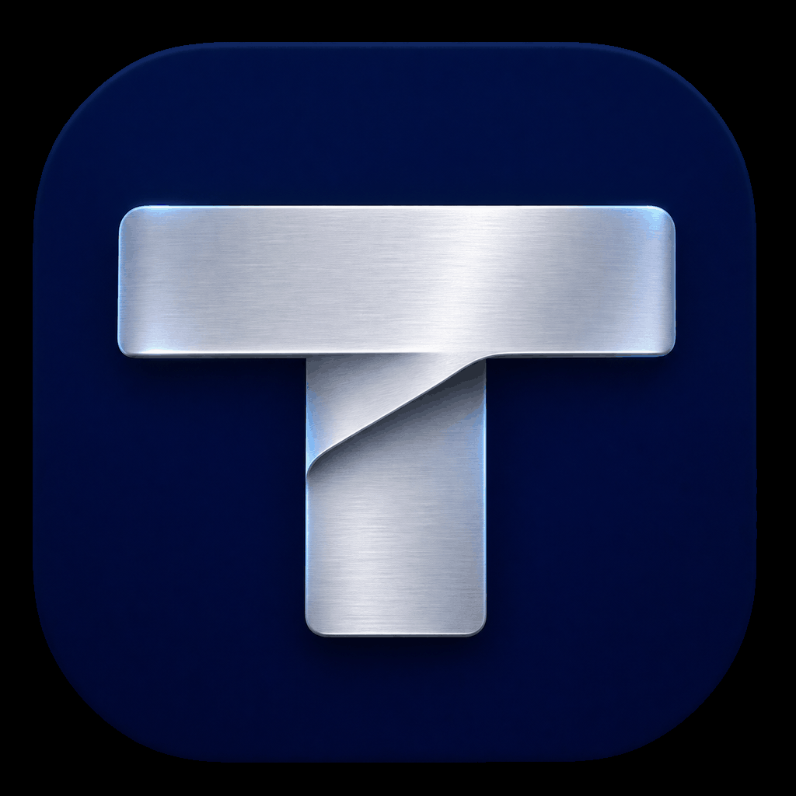

<p align="center">
  
</p>

<h1 align="center">Tooki</h1>

<p align="center">
  One small, native menu bar app for your Mac's keyboard, clipboard and menu bar.
</p>

<p align="center">
  <a href="https://github.com/tahsinature/tooki/releases/latest"></a>
  
  <a href="LICENSE"></a>
</p>

---

- **Hyper Key**: Caps Lock becomes `⌃⌥⇧⌘`, for shortcuts that never clash.
- **Shortcuts**: Bind any key combo to Tooki features or apps, and find out which app owns a shortcut.
- **Snippets**: Type `;date` and it expands, with placeholders for dates, the clipboard and arguments.
- **Clipboard**: Searchable history of text, links, colors, images and files. Paste, open or drag any item.
- **Menu Bar**: Hide the icons you rarely need, and search every menu bar item.
- **Keep Awake**: Stop your Mac from sleeping for a while, or while certain apps run.

## Install

```sh
brew trust tahsinature/tap
brew install --cask tahsinature/tap/tooki
```

Or download `Tooki.dmg` from the [latest release](https://github.com/tahsinature/tooki/releases/latest). Tooki needs **Accessibility** permission for the Hyper key, snippets and pasting.

## Docs

[Configuration](docs/CONFIGURATION.md) · [Development](docs/DEVELOPMENT.md) · [Releasing](docs/RELEASING.md)

## License

[GPL-3.0](LICENSE) © 2026 Mohammad Tahsin
